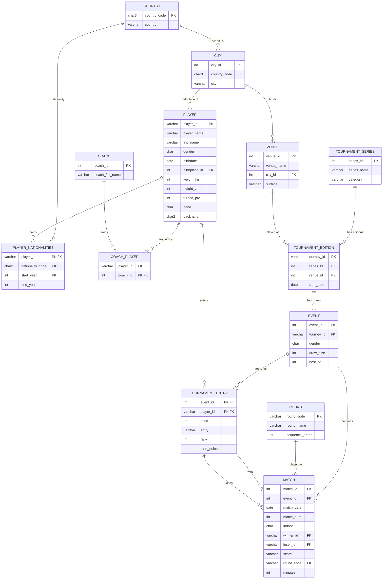

<div align="center">

# 🎾 Tennis Database

**A relational database for professional tennis, built in SQLite and analysed with SQL and Python.**


*INFOMDW – Data Wrangling · Assignment 1 · Group 8 · MSc Applied Data Science, Utrecht University*

</div>

---

## Table of contents

1. [Overview](#overview)
2. [Repository structure](#repository-structure)
3. [Entity–relationship diagram](#entityrelationship-diagram)
4. [Schema at a glance](#schema-at-a-glance)
5. [Dataset](#dataset)
6. [Getting started](#getting-started)
7. [Task 2: SQL queries and results](#task-2-sql-queries-and-results)
8. [Task 3: hashing analysis](#task-3-hashing-analysis)
9. [Report](#report)
10. [License](#license)

---

## Overview

The project covers three tasks:

| Task | Goal | Deliverable |
| --- | --- | --- |
| **1. Database design** | Model Grand Slam and Masters 1000 tennis data as a normalised relational schema with keys, constraints and referential actions, then load the data. | [`sql/01_schema.sql`](sql/01_schema.sql), [`sql/02_data.sql`](sql/02_data.sql) |
| **2. SQL queries** | Answer five questions covering a join, an aggregate, a nested query, a self join and a set operation. | [`sql/03_queries.sql`](sql/03_queries.sql) |
| **3. Python and hashing** | Query the database from Python, load a string attribute into a pandas DataFrame and evaluate a hash function by its collision rate. | [`notebooks/task_3.ipynb`](notebooks/task_3.ipynb) |

## Repository structure

```text
tennis-database-sqlite/
├── sql/
│   ├── 01_schema.sql     # Tables, keys, constraints, indexes, triggers
│   ├── 02_data.sql       # Data inserts, in one transaction
│   └── 03_queries.sql    # The five Task 2 queries
├── notebooks/
│   └── task_3.ipynb      # Task 3: Python, pandas and hashing
├── report/
│   └── Report_Group8_Assignment1.pdf
├── build.sql             # Runs the three SQL files in order
├── requirements.txt      # Python dependencies
├── LICENSE
└── README.md
```

## Entity–relationship diagram

Rendered automatically by GitHub. `PK` marks a primary key and `FK` a foreign key.



> `MATCH` also stores winner (`w_*`) and loser (`l_*`) serve statistics: aces, double faults, service points, first and second serve points won, service games and break points. They are left out of the diagram for readability.

## Schema at a glance

**13 tables**, grouped by role:

| Group | Tables |
| --- | --- |
| Geography | `country`, `city` |
| People | `player`, `coach` |
| Tournament hierarchy | `tournament_series` → `tournament_edition` → `event`, plus `venue` and `round` |
| Many-to-many links | `player_nationalities`, `coach_player`, `tournament_entry` |
| Results | `match` |

**Design choices**

- **Three-level tournament model.** A *series* (for example Wimbledon) has yearly *editions*, and each edition has *events* (the men's or women's draw).
- **Junction tables** resolve many-to-many relations: players and coaches, players and nationalities over time, and players and events.
- **Composite foreign keys.** A match's winner and loser must both appear in that event's entry list (`tournament_entry`), so a match cannot reference a player who did not enter the event.
- **Constraints enforce the domain.** `CHECK` rules restrict gender, handedness, backhand type, court surface, draw size and seeds. `UNIQUE` rules prevent duplicate rows.
- **Deliberate referential actions.** `ON DELETE RESTRICT`, `CASCADE` and `SET NULL` are chosen per relationship, so for example deleting a country that still has cities is refused.
- **Foreign keys are enabled explicitly** with `PRAGMA foreign_keys = ON`, because SQLite ignores them by default.

## Dataset

The data covers the **2025 season**: 13 tournaments (4 Grand Slams and 9 Masters 1000 events), each with one draw.

| Table | Rows | Table | Rows |
| --- | ---: | --- | ---: |
| `country` | 48 | `tournament_edition` | 13 |
| `city` | 186 | `event` | 13 |
| `player` | 218 | `round` | 7 |
| `coach` | 249 | `tournament_entry` | 1,296 |
| `coach_player` | 253 | `match` | 1,283 |
| `player_nationalities` | 218 | `venue` | 13 |
| `tournament_series` | 13 | | |

## Getting started

### Requirements

- SQLite 3 (`sqlite3` command-line tool)
- Python 3.10+

```bash
pip install -r requirements.txt
```

### 1. Build the database and run the queries

From the repository root:

```bash
sqlite3 tennis_assignment.db ".read build.sql"
```

This drops any old tables, rebuilds the schema, loads the data and prints the five query results. It stops at the first error (`.bail on`) and is safe to re-run. The generated `.db` file is git-ignored.

To run a single step, read just that file:

```bash
sqlite3 tennis_assignment.db ".read sql/01_schema.sql"
```

### 2. Run the Python analysis

The notebook rebuilds the database itself from `sql/`, so no setup is needed. Start Jupyter from the `notebooks/` folder:

```bash
cd notebooks
jupyter notebook task_3.ipynb
```

## Task 2: SQL queries and results

All queries are in [`sql/03_queries.sql`](sql/03_queries.sql). Results below come from the built database.

**Query 1, join.** Which tournaments were played on clay in the 2025 season?
Result: Madrid Masters, Monte Carlo Masters, Rome Masters and Roland Garros.

**Query 2, aggregate function.** What is the average match duration in each round, and which round lasts longest?

| Round | Avg. minutes |
| --- | ---: |
| Final | 140.5 |
| Round of 128 | 133.2 |
| Quarterfinal | 123.8 |
| Round of 32 | 123.4 |
| Round of 64 | 122.0 |
| Semifinal | 120.4 |
| Round of 16 | 114.8 |

The final is the longest round on average.

**Query 3, nested query.** Which players are taller than the average player? The subquery computes the average height of 186.4 cm. **101** of the 218 players are taller.

**Query 4, self join.** Which pairs of players were born in the same city? The database contains **73** such pairs, for example Novak Djokovic and Miomir Kecmanovic (Belgrade). Buenos Aires alone contributes 21 pairs.

**Query 5, set operation (`EXCEPT`).** Which players have no coach recorded? **30** players have no row in `coach_player`.

## Task 3: hashing analysis

[`notebooks/task_3.ipynb`](notebooks/task_3.ipynb) is organised in three parts:

1. **Connect and query.** Build the SQLite database from `sql/` and extract query results from Python.
2. **Load into pandas.** Read `coach_id` and `coach_full_name` from the `coach` table (249 rows) into the DataFrame `df_sim`.
3. **Hash and measure.** Hash each name to an index in `0 … m-1`, where `m = 249` is the table cardinality, and report the collision rate.

The hash function sums the character codes of a name and takes the result modulo `m`.

| Metric | Value |
| --- | ---: |
| Names hashed (`m`) | 249 |
| **Collision rate** | **39.36 %** |

**Finding.** The function ignores letter order, so names made of the same letters in a different order collide. Among 6 deliberately similar names, 3 shared the same index (`Adam Kellner`, `Kellner Adam` and `Adam Kellnre` all map to 124). A better function would weight each character by its position, for example a polynomial rolling hash.

## Report

The written report covers the design decisions and results: [`report/Report_Group8_Assignment1.pdf`](report/Report_Group8_Assignment1.pdf).

## License

Released under the [MIT License](LICENSE).

---

<div align="center">

*Group 8 · INFOMDW · Period 1, 2026–27*

</div>
