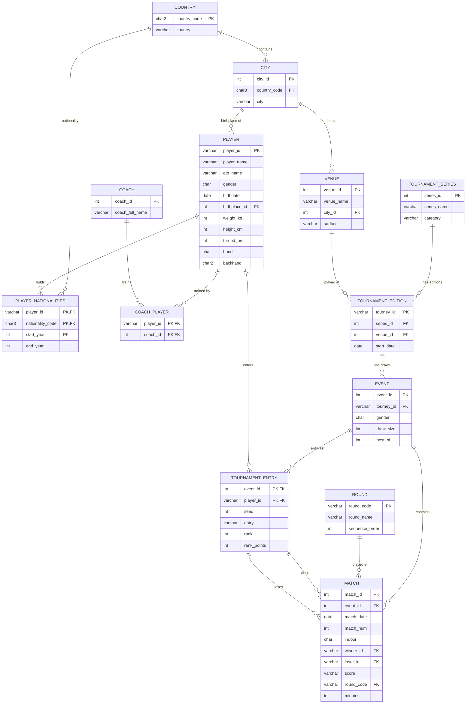

<div align="center">

# 🎾 Tennis Database

**A relational database for professional tennis, built in SQLite and analysed with SQL and Python.**


*INFOMDW – Data Wrangling · Assignment 1 · Group 8 · MSc Applied Data Science, Utrecht University*

</div>

---

## Table of contents

1. [Overview](#overview)
2. [Repository structure](#repository-structure)
3. [Entity–relationship diagram](#entityrelationship-diagram)
4. [Schema at a glance](#schema-at-a-glance)
5. [Getting started](#getting-started)
6. [Task 2: SQL queries](#task-2-sql-queries)
7. [Task 3: hashing analysis](#task-3-hashing-analysis)
8. [Report](#report)

---

## Overview

The project covers three tasks:

| Task | Goal | Deliverable |
| --- | --- | --- |
| **1. Database design** | Model Grand Slam and Masters 1000 tennis data as a normalised relational schema with keys, constraints and referential actions, then load the data. | [`tennis.sql`](tennis.sql) (part 1) |
| **2. SQL queries** | Answer five questions covering a join, an aggregate, a nested query, a self join and a set operation. | [`tennis.sql`](tennis.sql) (part 2) |
| **3. Python and hashing** | Query the database from Python, load a string attribute into a pandas DataFrame and evaluate a hash function by its collision rate. | [`task_3.ipynb`](task_3.ipynb) |

## Repository structure

```text
tennis-database-sqlite/
├── README.md                        # You are here
├── tennis.sql                       # Tasks 1 and 2: schema, data, queries
├── task_3.ipynb                     # Task 3: Python / pandas / hashing
├── report/
│   └── Report_Group8_Assignment1.pdf   # Written report
└── .gitignore
```

## Entity–relationship diagram

Rendered automatically by GitHub. `PK` marks a primary key and `FK` a foreign key.



> `MATCH` also stores winner (`w_*`) and loser (`l_*`) serve statistics: aces, double faults, service points, first and second serve points won, service games and break points. They are left out of the diagram for readability.

## Schema at a glance

**13 tables**, grouped by role:

| Group | Tables |
| --- | --- |
| Geography | `country`, `city` |
| People | `player`, `coach` |
| Tournament hierarchy | `tournament_series` → `tournament_edition` → `event`, plus `venue` and `round` |
| Many-to-many links | `player_nationalities`, `coach_player`, `tournament_entry` |
| Results | `match` |

**Design choices**

- **Three-level tournament model.** A *series* (for example Wimbledon) has yearly *editions*, and each edition has *events* (the men's or women's draw).
- **Junction tables** resolve many-to-many relations: players and coaches, players and nationalities over time, and players and events.
- **Composite foreign keys.** A match's winner and loser must both appear in that event's entry list (`tournament_entry`), so a match cannot reference a player who did not enter the event.
- **Constraints enforce the domain.** `CHECK` rules restrict gender, handedness, backhand type, court surface, draw size and seeds. `UNIQUE` rules prevent duplicate rows.
- **Deliberate referential actions.** `ON DELETE RESTRICT`, `CASCADE` and `SET NULL` are chosen per relationship, so for example deleting a country that still has cities is refused.
- **Foreign keys are enabled explicitly** with `PRAGMA foreign_keys = ON`, because SQLite ignores them by default.

## Getting started

### Requirements

- SQLite 3 (`sqlite3` command-line tool)
- Python 3.10+ with `pandas` and `jupyter`

```bash
pip install pandas jupyter
```

### 1. Build the database and run the queries

```bash
sqlite3 tennis_assignment.db
sqlite> .read tennis.sql
```

The script drops any old tables, rebuilds the schema, loads the data and runs the five queries. It stops at the first error (`.bail on`) and can be re-run safely.

### 2. Run the Python analysis

Keep `tennis_assignment.db` in the same folder as the notebook, then:

```bash
jupyter notebook task_3.ipynb
```

## Task 2: SQL queries

| # | Technique | Purpose |
| --- | --- | --- |
| 1 | Join | Combine related tables to answer a question across entities |
| 2 | Aggregate function | Summarise data with grouping and aggregates |
| 3 | Nested query | Use a subquery to filter or compare against computed values |
| 4 | Self join | Relate rows of a table to other rows of the same table |
| 5 | Set operation | Combine or compare result sets (`UNION`, `INTERSECT` or `EXCEPT`) |

The exact questions and SQL are in part 2 of [`tennis.sql`](tennis.sql).

## Task 3: hashing analysis

[`task_3.ipynb`](task_3.ipynb) is organised in three parts:

1. **Connect and query.** Open the SQLite database from Python and extract query results.
2. **Load into pandas.** Read a relation with a string attribute (names) into the DataFrame `df_sim`.
3. **Hash and measure.** Hash each string to an index in `0 … m-1`, where `m` is the table cardinality, and report the collision rate.

**Finding.** The hash function sums character codes, so it ignores letter order. Names made of the same letters in a different order collide. Among the 6 similar names tested, 3 shared the same index. The full collision rate is in the notebook and the report.

## Report

The written report covers the design decisions and results: [`report/Report_Group8_Assignment1.pdf`](report/Report_Group8_Assignment1.pdf).

---

<div align="center">

*Group 8 · INFOMDW · Period 1, 2026–27*

</div>
